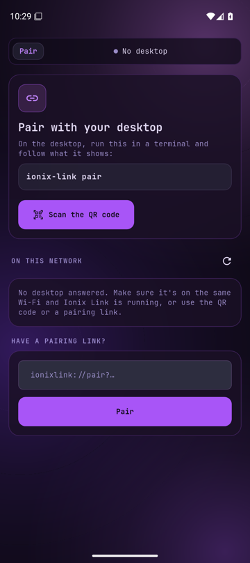
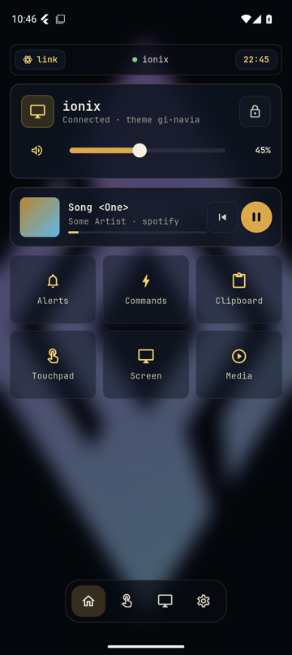
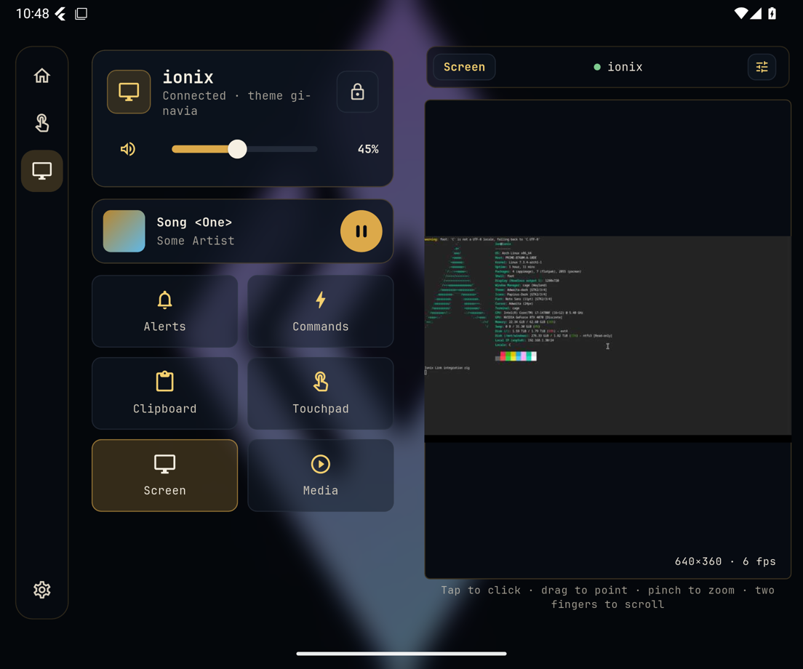

# Ionix Link

Your phone, on speaking terms with your Ionix desktop. Pair once, then read the desktop's notifications, skip the song, run your own commands, borrow the clipboard, and poke at the screen from the couch.

<p>
  
  
  
</p>
<sup>Pairing, the home screen, and an unfolded foldable showing the desktop's screen. Taken in an emulator against a test desktop.</sup>

## Key Features

- **Wears your desktop's theme**: the app takes its colours, corner radii and wallpaper from whatever theme is active on the desktop, and follows along when you switch. Until it has met a desktop it uses the stock Ionix purple.
- **Notifications**: what pops up on the desktop shows up on the phone, and, if you turn it on in the app's settings, what the phone gets shows up on the desktop (close it on either one and it closes on the other). Needs `notify-send` (libnotify) on the desktop.
- **Media remote**: play, pause, skip, seek and volume for whatever is playing.
- **Commands**: a list *you* define on the desktop, plus lock, suspend, log out, restart and shut down. The phone picks from the list and can never send a command of its own.
- **Clipboard**: send the phone's clipboard to the desktop, or fetch the desktop's.
- **Touchpad and keyboard**: one finger moves, tap clicks, two fingers scroll, and there is a keyboard for when the real one is too far away.
- **Screen view**: see a monitor on the phone and tap to click.
- **Phone desktop**: a monitor of the phone's very own, sized to fit it. Open apps on it, touch them with real multitouch, type with the phone's keyboard, and watch it at full resolution and 60 fps. Close it and its windows come back to your main monitor. Needs Hyprland.
- **Share to the desktop**: pick Ionix Link in any app's share menu. Links open on the desktop, text lands on its clipboard, and photos, videos and other files go to its Downloads folder.
- **Foldables**: one pane when folded, two panes split on the hinge when open, and picture-on-top, controls-below when half open on a table. Folding never loses your place.
- **Local and private**: everything stays on your network, encrypted, with no account and no cloud.

## Getting started

On the desktop (Ionix ships the `ionix-link-git` package; on other Arch systems it is on the AUR):

```bash
systemctl --user enable --now ionix-link.service   # on Ionix, new accounts have it on already
ionix-link pair
```

Scan the QR code with the app. No camera? The app also lists desktops it finds on the network: tap one, check that the six digits match the notification on the desktop, and accept.

The phone app is in `app/`. Build it with Flutter:

```bash
cd app
flutter build apk
```

## Desktop commands

- `ionix-link` or `ionix-link status`: the daemon, this desktop and its paired phones.
- `ionix-link pair`: show a QR code (valid for 2 minutes). `ionix-link pair accept|reject` answers a phone that asked with a code.
- `ionix-link devices`: list paired phones.
- `ionix-link unpair <DEVICE>`: forget a phone. Do this if you lose one.
- `ionix-link ring <DEVICE>`: make a phone ring, for when it is somewhere in the sofa.
- `ionix-link send-clipboard [DEVICE] [TEXT]`: send text, or the desktop's clipboard, to a phone.
- `ionix-link commands`: list what phones are allowed to run.
- `ionix-link desktop [close]`: show the phone desktop, or close it from the desktop side.

## Your own commands

`~/.config/ionix/link/commands.json`:

```json
{ "commands": [
  { "id": "backup", "title": "Run backup", "icon": "folder", "confirm": true, "group": "Tasks",
    "exec": ["systemctl", "--user", "start", "backup.service"] },
  { "id": "poweroff", "hidden": true }
] }
```

`exec` as a list is run as is; as a string it runs under `sh -c`. `"confirm": true` makes the phone ask first. An entry with a built-in's id changes it, and `"hidden": true` removes it.

`~/.config/ionix/link/config.json` holds the rest, all optional: `name` (what phones see), `discovery` (answer phones looking for desktops), `plugins` (switch a feature off, for example `{ "screen": false }`) and `notifications.ignoreApps`.

The phone desktop's touchscreen needs `/dev/uinput`. The package's udev rule gives it to whoever is logged in at the seat; log in again after installing it, or the device is still root's. Know what that rule allows: any program you run can then create input devices, a keyboard or mouse included, and so type and click as you (the same rule Steam ships for its controllers). Without the rule the phone desktop still opens, but without touch. To turn it off, mask it (an upgrade would bring back a deleted copy) and log in again: `sudo ln -s /dev/null /etc/udev/rules.d/70-ionix-link-uinput.rules`.

## Technical bits

- The desktop side is one Python file with no dependencies beyond the standard library, `bin/ionix-link`. It uses tools the desktop already has: `playerctl`, `wpctl`, `wl-clipboard`, `wtype`, `grim`, `wf-recorder`, `busctl`. A feature whose tool is missing is simply not offered.
- TCP and UDP port 47110. TLS with a self-signed certificate the phone pins when pairing, and an HMAC challenge on every connection. The wire format is in [PROTOCOL.md](PROTOCOL.md), the code layout in [STRUCTURE.md](STRUCTURE.md).
- Paired phones and the certificate live in `~/.local/share/ionix/link/`. The daemon writes `~/.local/state/ionix/link/state.json` for the desktop shell to read.
- The app is Flutter, Android first. It also builds for Linux, which is how its screens are previewed headless: `flutter build linux -t lib/ui/preview/preview_main.dart`.
- The font is JetBrains Mono Nerd Font (OFL), bundled in `app/assets/fonts/`.
